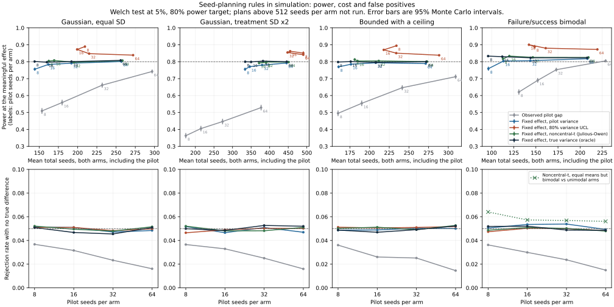

# mendel

To plan a comparison of two RL algorithms, choose the smallest effect you care about before the pilot. Use the pilot to estimate variance, then allow for uncertainty in that estimate. Mendel provides a seed-count planner and experiments comparing this approach with planning from the pilot's observed gap.

Julious and Owen's noncentral-t rule kept power at **79–83% for an 80% target** across four simulated score populations and pilots of 8–64 seeds per algorithm. Planning from the observed gap gave **36–81%**.



| Planning rule | 8-seed pilot: power | total seeds | 32-seed pilot: power | total seeds |
|---|---:|---:|---:|---:|
| Observed pilot gap | 36.3–62.1% | 131–174 | 44.6–75.3% | 173–273 |
| Fixed effect, pilot variance | 75.5–77.0% | 96–334 | 78.0–80.6% | 144–380 |
| Fixed effect, 80% variance UCL | 85.1–89.4% | 149–491 | 84.8–88.0% | 161–448 |
| Fixed effect, noncentral-t (Julious-Owen) | 79.6–81.7% | 113–390 | 79.7–82.6% | 147–391 |
| Fixed effect, true variance (oracle) | 79.8–83.3% | 96–334 | 79.6–82.3% | 144–382 |

Ranges cover Gaussian, unequal-variance Gaussian, bounded and failure/success populations, with a target effect of half the control SD. Total seeds include both algorithms and the pilot. Plans above 512 seeds per algorithm count as misses; UCL means upper confidence limit.

[Full results](results/calibration/report.md) · [Method](docs/CALIBRATION.md) · [Simulation tables](results/calibration/workflow.csv)

## What happened with PPO

I compared base PPO with four variants on CartPole-v1 and Acrobot-v1, using eight-seed pilots to plan for 80% power from each observed gap. After training 65,744 additional policies, **139/307 comparisons detected a difference (45.3%)**: 109/175 on CartPole and 30/132 on Acrobot. The true gaps vary across these comparisons, so this measures detection frequency; the simulation above isolates the planning rule.

[Training setup](docs/NEURAL_PROTOCOL.md) · [PPO summary](results/neural/summary.json) · [Every test](results/neural/outcomes.csv)

## Plan your seed count

```sh
uv sync --locked --python 3.12
uv run python scripts/plan.py --effect 0.5 --sd-a 1 --sd-b 1 --pilot-seeds 8
```

This returns **72 new training seeds per algorithm**, in addition to the eight pilot seeds. `--effect` is the smallest mean-return difference worth detecting, in the same units as the scores. `--sd-a` and `--sd-b` are the sample standard deviations across training seeds. The defaults are 80% power and a two-sided 5% test; change them with `--power` and `--alpha`.

The Python API takes **variances**, rather than standard deviations:

```python
from seed_power.stats import plan_seeds_with_pilot_uncertainty

n = plan_seeds_with_pilot_uncertainty(
    effect=0.5,
    variance_a=1.0,
    variance_b=1.0,
    pilot_seeds=8,
)
print(n)  # 72 seeds per algorithm, excluding the pilot
```

Omitting `--pilot-seeds` treats the supplied SDs as known and gives 64 per algorithm for this example. A zero effect or zero total variance returns `null` in the CLI and `None` in Python.

## Check the results

These commands recompute the simulation and null-control diagnostics from the saved scores without training policies:

```sh
MPLBACKEND=Agg uv run python scripts/calibrate.py --check
MPLBACKEND=Agg uv run python scripts/null_diagnostics.py --check
uv run python -m pytest -q
```

[Analysis commands and training instructions](docs/RUNNING.md) include the earlier affine ARS/CEM experiment, which detected differences in 67/119 comparisons (56.3%) under the same observed-gap planning approach.

## Where the answer applies

- The recommended rule was tested on four simulated populations with one target effect size and on resampled PPO scores. Training new policies to test that rule remains open.
- Choosing the effect matters: when the true effect was half the planned effect, the fixed-effect rules reached only 28.4–41.3% power.
- PPO covers two classic-control tasks with fixed evaluation resets. Each training seed is one replicate; evaluation episodes are measurements of that policy. The 93/400 comparisons requiring more than 512 seeds per algorithm were not run.
- Same-variant PPO controls rejected 7/74 times, including 5/36 on CartPole. The [null-control diagnostics](results/neural/null_diagnostics.md) did not identify a cause.

The planner uses established methods from [Browne](https://doi.org/10.1002/sim.4780141709) and [Julious and Owen](https://pubmed.ncbi.nlm.nih.gov/17080926). [Related RL work and attribution](docs/PRIOR_WORK.md). Code is [MIT](LICENSE); third-party notices are included.
