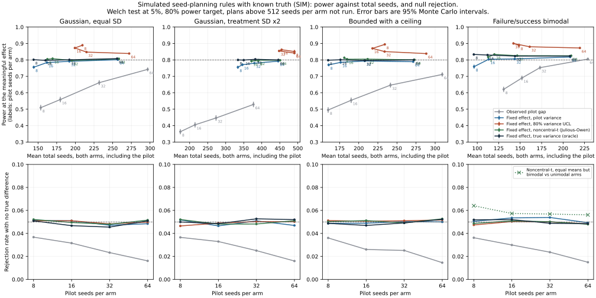

# mendel

How many independent training seeds do I need?

Fix the smallest effect you care about before the pilot, and use the pilot only for its variance, with an allowance for how uncertain that variance is. In a known-truth simulation (SIM) with Gaussian, bounded and failure/success bimodal score populations, that rule (Julious and Owen's noncentral-t count) kept power at **79.3–83.3%** for an 80% target at every pilot size from 8 to 64 seeds per arm. Planning from the gap the pilot happened to observe, as my fresh-seed experiments did, gave **36.3–80.5%**. Plugging the pilot variance in directly gave **75.5–77.0%** with 8-seed pilots.

| Planning rule | 8-seed pilot: power | total seeds | 32-seed pilot: power | total seeds |
|---|---:|---:|---:|---:|
| Observed pilot gap | 36.3–62.1% | 131–174 | 44.6–75.3% | 173–273 |
| Fixed effect, pilot variance | 75.5–77.0% | 96–334 | 78.0–80.6% | 144–380 |
| Fixed effect, 80% variance UCL | 85.1–89.4% | 149–491 | 84.8–88.0% | 161–448 |
| Fixed effect, noncentral-t (Julious-Owen) | 79.6–81.7% | 113–390 | 79.7–82.6% | 147–391 |
| Fixed effect, true variance (oracle) | 79.8–83.3% | 96–334 | 79.6–82.3% | 144–382 |

Ranges run over four simulated populations, each with a meaningful effect of half the control SD; total seeds count both arms and the pilot. I check the simulation against exact Gaussian quadrature. On committed PPO roots, resampled into disjoint pilots and confirmations (not new training), the same rule gave **80.5–82.6%** power for a known shift and rejected **4.5–5.3%** of base-versus-base nulls.



[Calibration report](results/calibration/report.md) · [Method](docs/CALIBRATION.md) · [Every simulated row](results/calibration/workflow.csv)

## What the fresh-seed experiments found

I planned neural PPO comparisons for **80% modeled power** from eight-seed pilots, using each pilot's observed gap. On fresh seeds, **139/307 detected a difference (45.3%)**, with a descriptive Wilson 95% interval of **39.8–50.9%**. My earlier affine ARS/CEM experiment detected **67/119 (56.3%; 47.3–64.9%)**. I compare base PPO with faster/slower learning rates, fewer update epochs and no entropy coefficient.

| Fresh-seed detections | Affine ARS/CEM | Neural PPO |
|---|---:|---:|
| All executable different-variant plans | 67/119 (56.3%) | 139/307 (45.3%) |
| CartPole-v1 | 30/60 (50.0%) | 109/175 (62.3%) |
| Acrobot-v1 | 37/59 (62.7%) | 30/132 (22.7%) |

Same-variant controls rejected in **7/74 tests (9.5%; 4.7–18.3%)**.

CartPole-v1 rejected 5/36 of its controls, and I could not explain that excess. Four other tests reject 3 to 6 of the 36. Resampling held-out base roots at the planned counts, Welch should reject only 1.80. Training batches, arms and phases show no effect. Adjusted for two tasks, 5 or more rejections is a 0.065 event ([null-control diagnostics](results/neural/null_diagnostics.md)).

These rates mix comparisons whose true gaps differ, and some variants may have almost no true gap, so they are not power at a known effect. The simulation above is what separates the planning rule from the comparisons.


[Neural summary](results/neural/summary.json) · [Every test](results/neural/outcomes.csv) · [Original summary](results/summary.json) · [Vector figure](figures/neural_vs_linear.svg)

## How many seeds?

I use this planner for a fixed mean gap and two standard deviations. With `--pilot-seeds`, it treats the SDs as estimates from that many pilot seeds per arm and applies the noncentral-t rule above:

```sh
uv sync --locked --python 3.12
uv run python scripts/plan.py --effect 0.5 --sd-a 1 --sd-b 1
uv run python scripts/plan.py --effect 0.5 --sd-a 1 --sd-b 1 --pilot-seeds 8
```

The first command gives 64 seeds per arm and the second 72. For an illustrative equal-variance Gaussian pooled-t model with known SDs, two-sided alpha=0.05 and 80% power:

| Standardized mean gap | Seeds per arm |
|---|---:|
| 0.2 | 394 |
| 0.5 | 64 |
| 0.8 | 26 |
| 1.0 | 17 |

## What I built

I adapt MIT [coldstart PPO](https://github.com/mottopanikeiku/coldstart/blob/b090dad8a3b53f937782676c6033ba3557cedfa1/control_clock/jax_ppo.py), inspired by Apache-2.0 PureJaxRL. Actor and critic each have two 32-unit tanh hidden layers. I train independent roots in a compiled `vmap` ([implementation](src/seed_power/neural.py)).

I train every seed for exactly **32,768 CartPole** or **65,536 Acrobot** environment transitions, without qualification stopping. I average sixteen deterministic-argmax evaluation episodes on fixed task-specific reset seeds shared across variants and phases. I count only each first episode, ending at termination or 500 steps. I describe the comparisons and collection in the [neural protocol](docs/NEURAL_PROTOCOL.md) and [original protocol](docs/PROTOCOL.md).

## Reproduce

Recompute from committed scores without training or paid compute:

```sh
uv run python scripts/calibrate.py
uv run python scripts/null_diagnostics.py
uv run python scripts/neural_analyze.py confirmation
uv run python scripts/neural_figures.py
uv run python scripts/analyze.py confirmation
uv run python scripts/public_analysis.py
```

`uv run python scripts/calibrate.py --check` regenerates the calibration and compares it with the committed files; `scripts/null_diagnostics.py --check` does the same for the null-control diagnostics. CI runs both on x86-64 and arm64. [Cloud reproduction and tests](docs/RUNNING.md).

## Limits

- The calibration is a simulation of four stylized populations with one effect size, plus resampling of committed roots. Resampling reuses the same roots, conditions on the fixed evaluation resets and is not a prospective test of the recommended rule on newly trained seeds.
- Every fixed-effect rule needs an effect chosen in advance. If the true effect is only half of it, simulated power falls to 28.4–41.3%.
- These are detection frequencies in two fixed classic-control designs, not true power at known effects or a general deep-RL benchmark. I did not run **93/400** different-variant plans above the **512-seed-per-arm** limit.
- The noncentral-t planner uses noisy pilot gaps and variances with fixed Welch degrees of freedom. Bounded, skewed returns may not fit its model, and different variants may have no true mean gap. I cannot attribute every missed detection to pilot noise or claim exact 5% calibration. The CartPole null controls rejected 5/36, and my [diagnostics](results/neural/null_diagnostics.md) do not explain why.
- Episodes measure each trained policy; they are not independent training replicates. Inference is conditional on the fixed reset sets and executable plans.
- The affine and neural experiments differ in optimizers, horizons, budgets, reset handling, precision and comparison mix. Their rate difference is not a causal effect of neural policies.

I use established seed-count guidance, not a new formula: [Henderson](https://arxiv.org/abs/1709.06560), [Colas](https://arxiv.org/abs/1806.08295), [Agarwal/rliable](https://arxiv.org/abs/2108.13264), [Patterson](https://arxiv.org/abs/2304.01315v1). The variance allowances are [Browne (1995)](https://doi.org/10.1002/sim.4780141709) and [Julious and Owen (2006)](https://pubmed.ncbi.nlm.nih.gov/17080926). [Attribution and licenses](docs/PRIOR_WORK.md). Code is MIT; third-party notices are retained.

Written with AI coding assistance.
