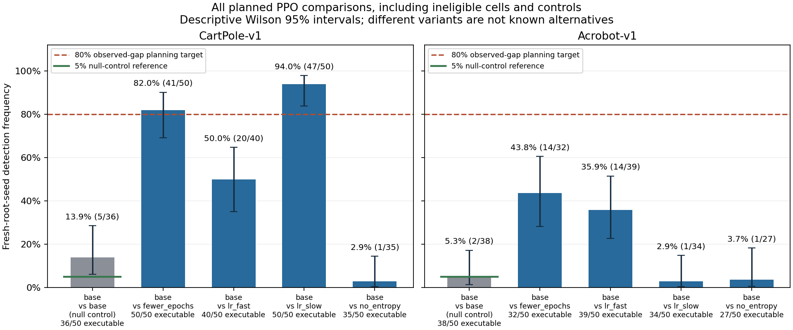

# mendel

Plans how many training seeds you need to compare two RL algorithms, starting from a small pilot.

```sh
uv sync --locked --python 3.12
uv run python scripts/plan.py --effect 0.5 --sd-a 1 --sd-b 1 --pilot-seeds 8
```

`--effect` is the smallest gap in mean return worth detecting, in score units, and `--sd-a`/`--sd-b` are the across-seed SDs from your pilot. This example asks for 72 fresh seeds per algorithm. If the SDs were known exactly (drop `--pilot-seeds`) it would be 64; the extra eight pay for having estimated them from 8 seeds. Defaults are 80% power and a two-sided 5% Welch test.

```python
from seed_power.stats import plan_seeds_with_pilot_uncertainty

plan_seeds_with_pilot_uncertainty(effect=0.5, variance_a=1.0, variance_b=1.0, pilot_seeds=8)  # 72
```

The Python API takes variances, not SDs.

## How the rules compare

Simulated power and seed cost of five planning rules, for a target effect of half the control SD, over four score shapes (Gaussian, unequal-variance Gaussian, ceiling-bounded, failure/success):

| Planning rule | Power, 8-seed pilot | Total seeds | Power, 32-seed pilot | Total seeds |
|---|---:|---:|---:|---:|
| Observed pilot gap | 36–62% | 131–174 | 45–75% | 173–273 |
| Fixed effect, pilot variance | 76–77% | 96–334 | 78–81% | 144–380 |
| Fixed effect, 80% variance upper limit | 85–89% | 149–491 | 85–88% | 161–448 |
| Fixed effect, noncentral-t (`plan.py`) | 80–82% | 113–390 | 80–83% | 147–391 |
| Fixed effect, true variance (oracle) | 80–83% | 96–334 | 80–82% | 144–382 |

Total seeds count both algorithms plus the pilot, and a plan over 512 seeds per algorithm counts as a miss. Planning from the gap you happened to see in the pilot is the one to avoid. `plan.py` uses Julious and Owen's noncentral-t rule: fix the effect in advance, then inflate the pilot's variance for its own uncertainty. It stayed at 79–83% power for pilots of 8 to 64 seeds and costs a little more than an oracle that knows the true variance.


The full simulation report is [`results/calibration/report.md`](results/calibration/report.md).

## 74,000 PPO policies

The real-training experiment planned with the observed-gap rule: base PPO against four variants on CartPole and Acrobot, 8-seed pilots, then 65,744 fresh policies at the planned counts. 139 of 307 comparisons found a difference. The true gaps are unknown there, so that's a detection rate, not power.



Base-vs-base controls rejected 7 of 74 times at a nominal 5%, five of them on CartPole. That could be chance or a small shared shift between seed blocks, and the [diagnostics](results/neural/null_diagnostics.md) can't tell which.

## Reproduce

```sh
uv sync --locked --python 3.12 --extra neural
MPLBACKEND=Agg uv run python scripts/calibrate.py --check
MPLBACKEND=Agg uv run python scripts/null_diagnostics.py --check
uv run python -m pytest -q
```

These recompute the simulation, the resampling checks and the null diagnostics from saved scores, without training anything. The simulation design, retraining on Modal and the tags that pin the pre-registered plans are in [docs/method.md](docs/method.md).

The rules come from [Browne (1995)](https://doi.org/10.1002/sim.4780141709) and [Julious and Owen (2006)](https://pubmed.ncbi.nlm.nih.gov/17080926). PPO adapts [coldstart](https://github.com/mottopanikeiku/coldstart) and follows [PureJaxRL](https://github.com/luchris429/purejaxrl). MIT license; third-party notices in `third_party/` and `docs/`.
